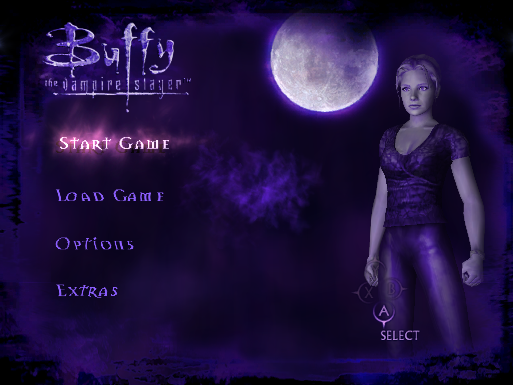
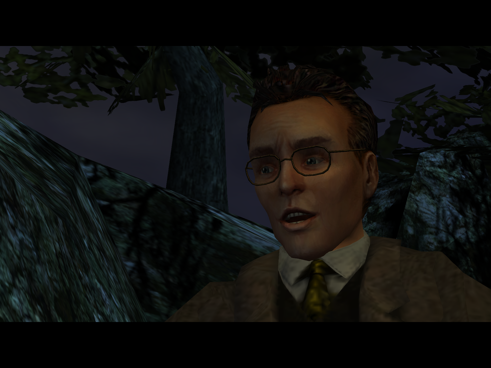
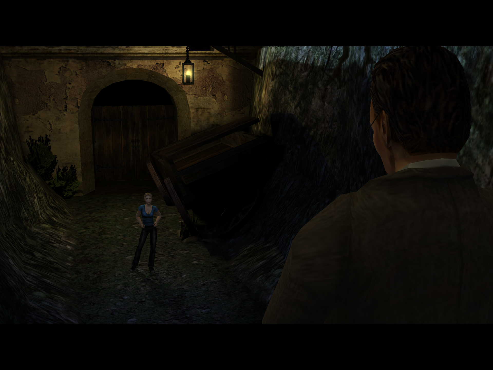
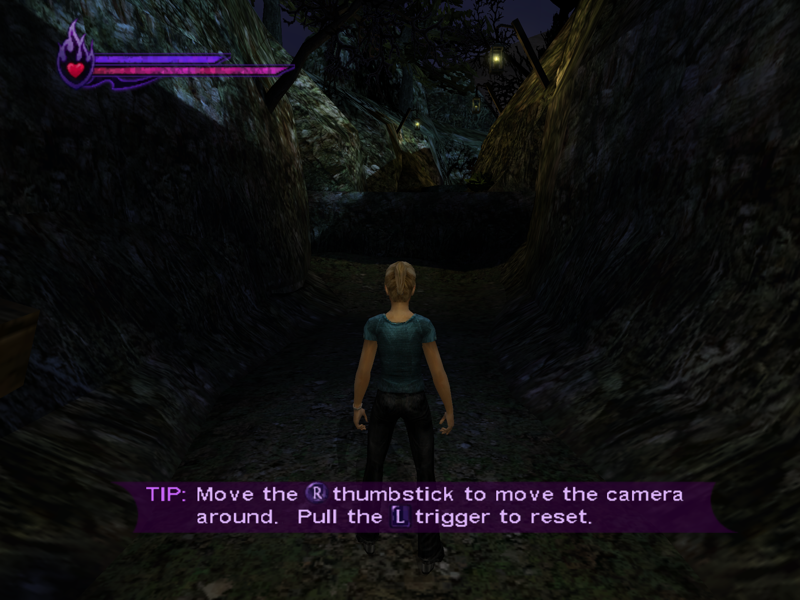

# Hellmouth

*Buffy the Vampire Slayer* (Xbox, 2002), running natively on Apple Silicon Macs. Bring your own disc.

Hellmouth is a static recompilation, not an emulator. The game's x86 code is translated to C++ ahead of time and built into
a Mac program, and the Xbox kernel and libraries are implemented on the Mac. It also adds something the original never had:
25 achievements, built into the game.

> **No game files are included,** and no code generated from them. The installer builds the app on your Mac from your own
> copy of the disc. A built copy contains the recompiled game, so there's no ready-made app to download, and please don't
> share one. Hellmouth is an unofficial fan
> project, and isn't affiliated with or endorsed by the owners of *Buffy the Vampire Slayer*, The Collective, Fox Interactive,
> Electronic Arts, Microsoft or Apple. Please report problems [here](https://github.com/djrobson5/Hellmouth/issues), not to the
> projects credited below.

## Screenshots

Taken from the port at its default settings, in 4:3.

| | |
|---|---|
|  |  |
| The main menu | Giles in the opening cutscene |
|  |  |
| Giles and Buffy at the Spanish Mission | The moment the player takes over |

## Status

**Experimental. It hasn't been played through to the end yet.**

Working: the game installs itself, plays its logos and movies, and its menus work. It runs at 60 frames a second on the GPU
through Vulkan and MoltenVK, at full Retina resolution, with sound, controllers and keyboard. The opening levels have been
played.

Not proven yet:

- **Later levels:** everything past `m00_spanishmission_2` has only been loaded in tests, not played.
- **Achievements:** each one's code has been exercised by scripted play or test drivers, or shares a code path with one that
  has, but none has been earned in a real playthrough. `docs/xdk-4432.md` says how each was tested.
- **Other Macs:** it has been tested on one machine, an M5 Pro with 64 GB of memory on macOS 27.0.1.
- **Windows:** the SDK underneath also targets Windows, but this port's changes haven't been compiled there.

Levels are very dark near the camera, with hard-edged shadows. That's the game's own lighting, and it matches footage of the
game. The game's Brightness slider (Options, Display) lifts it.

## What you need

- An Apple Silicon Mac, with the Xcode Command Line Tools (`xcode-select --install`) and [Homebrew](https://brew.sh).
- A disc image (`.iso`) of the **USA Xbox release**, or the game partition alone. To check it, `tools/regen.sh` extracts
  `assets/Default.xbe`, whose SHA-1 should be `2583fb651fafc10d47e34daae91fab9a8b9e1494`. Whole-disc images hash differently
  from each other, so that file is the one to compare. The port hooks exact addresses in this build, so other releases aren't
  expected to work; `--any-release` lets one start if you want to try.
- About 450 MB of disk for the build, which took about a minute on an M5 Pro, plus the game's own install on first start.

## Installing it

1. Download `Hellmouth-<version>.zip` from [Releases](https://github.com/djrobson5/Hellmouth/releases/latest) and unzip it.
2. In Terminal, run the installer, with the path to your disc image (you can drag each file into the Terminal window):

   ```sh
   bash ~/Downloads/Hellmouth-<version>/install.sh "<path to image.iso>"
   ```

The installer checks your Mac and your disc, offers to install any Homebrew packages that are missing, recompiles the game and
builds the app, then puts it in `/Applications` as `Buffy.app`. Open it and choose your disc image when it asks. The first build
needs a network connection. Installing again leaves your saves and settings alone.

## Building it by hand

```sh
brew install cmake pkgconf ffmpeg sdl3 molten-vk vulkan-headers glslang
git clone https://github.com/djrobson5/Hellmouth.git
cd Hellmouth

tools/regen.sh "<path to image.iso>"
sdk/host/build.sh -r . -g generated/game -o build/app -n Buffy
sdk/host/bundle.sh build/app/Buffy build/Buffy.app
open build/Buffy.app
```

`regen.sh` reads your disc to make `assets/` (the game's program, its linker map, the Dock icon and the achievement icons),
builds the recompiler, and recompiles the game into `generated/game`. CMake fetches Zydis and toml++, and `build.sh` fetches
Dear ImGui, so the first build needs a network connection.

The app asks for the disc image at its first start and remembers it, asking again if the file has moved. Its settings, hard
disk and logs go in `~/Library/Application Support/Buffy`. It's signed ad hoc for your own Mac and needs the macOS version it
was built on or later, as Homebrew's libraries do.

To run without the app: `build/app/Buffy "<path to image.iso>"`. The hard disk and log (`hdd/`, `logs/`) then go beside the
executable unless `--saves` or `--log` say otherwise. To change settings there, create `settings.toml` beside it, or name a
file with `--config`, which is filled in with the defaults. Keep the name `Buffy`: the game restarts itself to load a level,
and the restart looks for that name beside the running executable. The window closes and opens again when that happens.

## Achievements

The original game has no achievements, so Hellmouth adds 25: one for each boss, plus kills, secrets, finishing the game on
Hard, and a few jokes. They are part of the game and need nothing else installed.

- **When you earn one,** a note appears in the bottom right corner for six seconds, with a picture cut from your own disc.
  `[achievements] notify = false` in the settings file turns the note off.
- **The list** is on the Achievements page of the in-game menu: press F10 (fn+F10 on a Mac keyboard), then Page Up and Page
  Down, or a controller's shoulder buttons. Descriptions name places rather than bosses, so it's safe to read, and it shows the
  time you earned each one.
- **Your progress** is a plain text file, `~/Library/Application Support/Buffy/logs/achievements.txt` for the app, or
  `achievements.txt` beside the executable when it's run on its own.
- **The rules:** cheats don't disqualify you, existing saves earn nothing, and only kills credited to Buffy count.

No picture is shown before it's earned, as some show a boss. To use a different picture, edit `PICKS` in
`tools/make_achievement_icons.py` and run it on your disc, then build and bundle again. The list is in
`src/common/game_info.cpp`, and what earns each one is in `src/game/achievements.cpp`.

## Playing

Keys, by default: WASD moves, Enter or left click is A, Left Ctrl or Backspace is B, Q is X, right click is Y, Esc is Start.
`sdk/runtime/core/keys.h` has the rest, and `[keyboard]` in the settings file changes them. Controllers come through SDL.

| Key (with fn on a Mac keyboard) | What it does |
|---|---|
| F10, or both stick clicks | Open the settings menu and pause the game. F10, Esc or B goes back |
| F6 | 120 frames a second, until the game is closed |
| F7 | Show or hide the frame rate |
| F8 | Turn texture packs off and on |
| `\` | Save a PNG of the picture, without the menu or the bars, in `Screenshots` beside the game |
| `[` | Turn sharpening off and on |
| `]` | Step through the colour looks |

The menu holds the settings that take effect at once, and saves them on closing. The frame rate counter reads 0 while the game
stands still, and movies show their own rate of about 30.

## Settings

Everything below goes in `settings.toml`, in `~/Library/Application Support/Buffy` for the app. Enhancements are off by default,
except where it says otherwise.

- `[display] mode = "fullscreen"` uses macOS's own full screen at the desktop's resolution. `[display] show_fps = true` puts the
  frame rate in the window's title.
- `[graphics] widescreen = true`, or the menu's "Widescreen correction", shows levels at 16:9 with more of the scene at the
  sides, and the HUD and text in proportion. The front end and movies stay 4:3 with bars. The default window becomes 1280x720.
- `[display] high_frame_rate = true`, or the menu's "120 frames a second", runs at 120 on a screen that shows 120. Game speed
  holds. Characters' positions still step at 60 a second, as the game is built that way; the camera and everything else update
  on every frame. Movies keep their own rate.
- `[graphics] brightness` (0.5 to 2, 1 by default) is a curve over the picture, on top of the game's own Brightness slider.
- `[graphics] renderer = 0` uses the software renderer, at a few pictures a second. The game also falls back on it if MoltenVK
  can't start.

The menu's picture settings:

- **SMAA** smooths jagged edges at little cost. **Sharpening** (0 to 100) also sharpens the HUD's pictures. **Colour look** and
  **Look strength** grade the picture. All three change the picture at once, screenshots included, and leave movies' pictures
  alone, apart from the colour look.
- **Original texture softness** draws the 3D textures at the detail the Xbox showed at 480 lines, and leaves 2D alone.
- **Smooth menus and HUD** upscales the 2D pictures the game reads unfiltered. It's on by default and subtle here: the HUD and
  button icons change, while the text is filtered already.

### Texture packs

PNG or DDS files at any size go in their own folder under `textures/replace` beside the game
(`~/Library/Application Support/Buffy/textures/replace` for the app), read when the game or a level starts. Each file's name ends
in the texture's size and hash, as `hud_256x64_0123456789abcdef.png`. The menu's "Save game textures" writes every texture the game
uses to `textures/dump` under those names, and the log says which ones are 2D. Cube and volume textures and linear ones can't be
replaced.

### For testing

`SCRIPT=<file>` presses buttons on a virtual controller (see `sdk/host/script_pad.cpp`), `FPS=N` overrides the 60 frames a second,
`FPS_LOG=1` logs the frame rate, `AUDIO_LOG=1` logs how loud the sound is each second, and `REF=N` shows every Nth frame with the
software renderer (6 by default). `MTL_HUD_ENABLED=1` shows Apple's fuller overlay of frame times, GPU time and memory.

To run with no window:

```sh
sdk/harness/build.sh -r . -g generated/game -o build/harness -n Buffy
mkdir -p runs/test && cd runs/test
REF=30 FPS=30 ../../build/harness/Buffy "<path to image.iso>"
```

Frames land in `cap/` as `.tga` files and the log in `logs/`, under the folder it's run from. `sdk/harness/README.md` lists the
other settings, including pad scripts.

## Layout

| Path | What it is |
|---|---|
| `sdk/` | The recompiler and runtime, from Athelas (see Credits), with changes for this game: `docs/sdk-changes.md` |
| `sdk/host/` | The macOS program: window, events and sound |
| `sdk/xdk/4432/layout.toml` | This XDK's data layouts, each value with the instruction that proves it |
| `src/` | The game's side of the port: the achievement list, the hooks, widescreen |
| `install.sh` | The installer: the steps under "Building it by hand", with checks |
| `tools/` | `regen.sh`; `make_config.py` writes the recompiler's input; `disasm.py` disassembles by name; `coverage.py` reports what the game calls in the libraries |
| `docs/xdk-4432.md` | How this game differs from what the SDK expected, and the evidence |
| `assets/`, `config/game.toml`, `generated/`, `build/` | Not in the repository: the game's files, what's derived from them, and build output |

## Credits

Made by Dustin Robson. Hellmouth stands on other people's work, and they deserve the thanks.

**The game.** [The Collective](https://en.wikipedia.org/wiki/The_Collective_(company)) made it, and Fox Interactive and Electronic
Arts published it. The achievement names borrow from the show's episode titles and lines.

**The recompilation work this port is built on:**

- [Athelas](https://github.com/Shagg88/Athelas) by Shagg: the SDK here is copied from its Xbox ports, including the achievement
  system Hellmouth's list runs on.
- [XboxXBERecomp](https://github.com/TGP482/XboxXBERecomp) by TGP482, with Joshhhuaaa: the tool for statically recompiling
  original Xbox games, first made for [Splinter Cell: Double Agent](https://github.com/TGP482/SCDoubleAgent-XBERecomp). Hellmouth
  wouldn't exist without it.
- [XenonRecomp](https://github.com/hedge-dev/XenonRecomp) by hedge-dev: XboxXBERecomp follows its overridable function layout and
  instruction hooks.

**References for how the Xbox behaves.** No emulator code is used:
[xemu](https://github.com/xemu-project/xemu), [Cxbx-Reloaded](https://github.com/Cxbx-Reloaded/Cxbx-Reloaded) and
[XbSymbolDatabase](https://github.com/Cxbx-Reloaded/XbSymbolDatabase).

**Open-source projects it uses:**

| Project | What for | Licence |
|---|---|---|
| [MoltenVK](https://github.com/KhronosGroup/MoltenVK) | Vulkan on Metal | Apache 2.0 |
| [SDL](https://github.com/libsdl-org/SDL) | Window, sound, input and controllers | zlib |
| [Dear ImGui](https://github.com/ocornut/imgui) by Omar Cornut | The settings menu and achievement notes | MIT |
| [Zydis](https://github.com/zyantific/zydis) | Decoding x86 instructions in the recompiler | MIT |
| [toml++](https://github.com/marzer/tomlplusplus) by Mark Gillard | Config and settings files | MIT |
| [glslang](https://github.com/KhronosGroup/glslang) and [SPIRV-Tools](https://github.com/KhronosGroup/SPIRV-Tools) | Compiling shaders | Their own, mostly BSD-style and Apache 2.0 |
| [Vulkan-Headers](https://github.com/KhronosGroup/Vulkan-Headers) | The Vulkan API | Apache 2.0 or MIT |
| [SMAA](https://github.com/iryoku/smaa) by Jorge Jimenez, Jose I. Echevarria, Belen Masia, Fernando Navarro and Diego Gutierrez | Anti-aliasing | MIT |
| [stb](https://github.com/nothings/stb) by Sean Barrett | Reading and writing PNG files | MIT or public domain |
| [Liberation Fonts](https://github.com/liberationfonts/liberation-fonts) | The menu's font | SIL OFL 1.1 |
| [FFmpeg](https://ffmpeg.org) | Making the Dock icon, as a command-line tool | LGPL/GPL |
| [Homebrew](https://brew.sh) | Installing the libraries | BSD 2-clause |

The SDK also keeps NVIDIA [Streamline](https://github.com/NVIDIA-RTX/Streamline) and AMD
[FidelityFX](https://github.com/GPUOpen-LibrariesAndSDKs/FidelityFX-SDK) headers (MIT) for its Windows renderer. They aren't used on
the Mac.

## Licence

Hellmouth's own code is under the MIT licence: `LICENSE`. `sdk/` comes from MIT-licensed projects: `sdk/LICENSE` and
`sdk/ATHELAS-LICENSE`. Third-party code keeps its own licence: `sdk/THIRD_PARTY.txt`, `sdk/licenses/` and the licence files beside
that code. None of this covers the game or the screenshots of it in `docs/screenshots/`, which belong to the game's owners.
