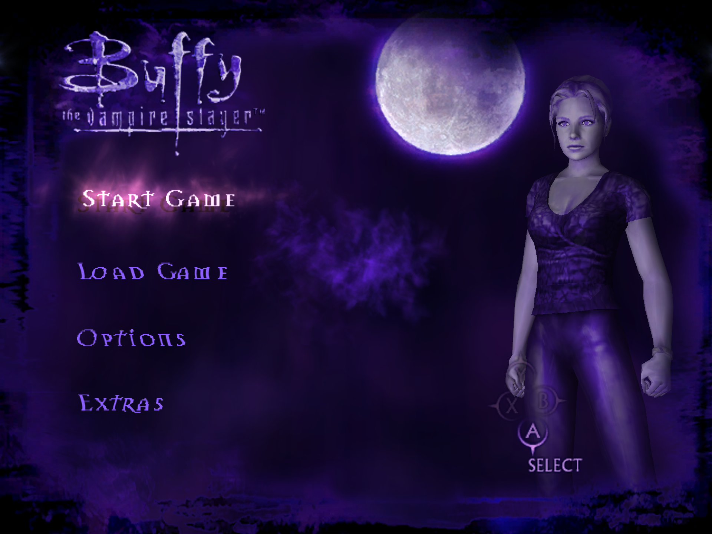
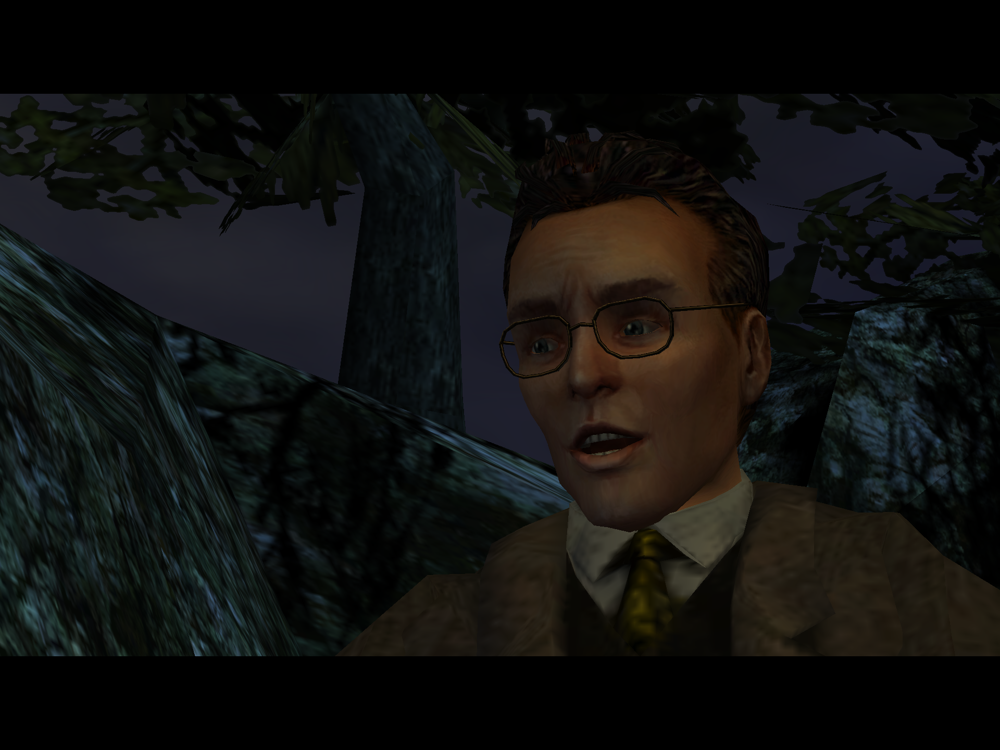
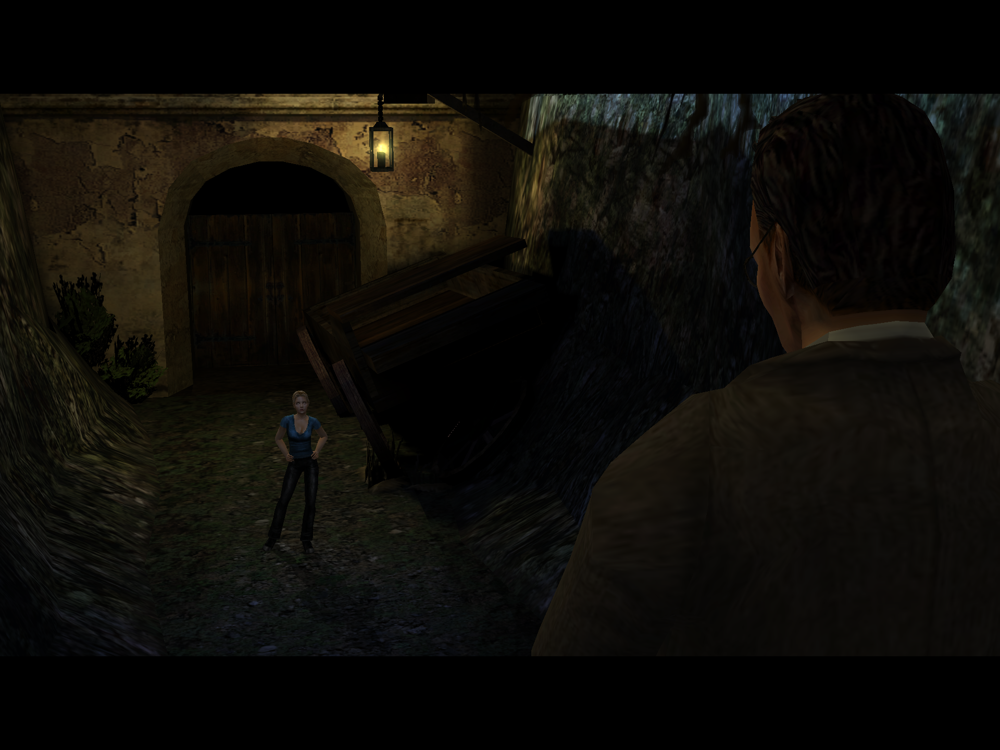
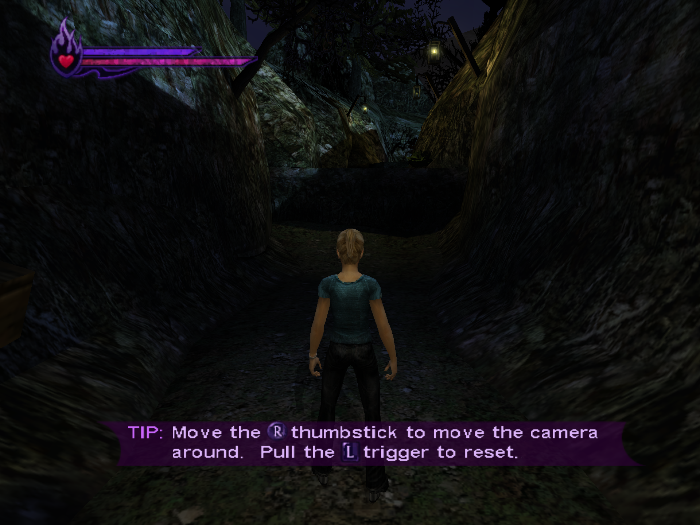

# Hellmouth

*Buffy the Vampire Slayer* (Xbox, 2002), running natively on Apple Silicon Macs. Bring your own disc.

Hellmouth is a static recompilation, not an emulator. The game's x86 code is translated to C++ ahead of time and built into
a Mac program, and the Xbox kernel and libraries are implemented on the Mac. It also adds something the original never had:
28 achievements, built into the game.

<a href="https://recomplauncher.com/game/hellmouth-buffy-recomp"><picture><source media="(prefers-color-scheme: dark)" srcset="https://recomplauncher.com/assets/press/launcher/badge-light.svg"></picture></a>

> **No game files are included,** and no code generated from them. The installer builds the app on your Mac from your own
> copy of the disc. A built copy contains the recompiled game, so there's no ready-made app to download, and please don't
> share one. Hellmouth is an unofficial fan
> project, and isn't affiliated with or endorsed by the owners of *Buffy the Vampire Slayer*, The Collective, Fox Interactive,
> Electronic Arts, Microsoft or Apple. Please report problems [here](https://github.com/djrobson5/Hellmouth-buffy-recomp/issues), not to the
> projects credited below.

## Screenshots

Taken from the port at its default settings, in 4:3.

| | |
|---|---|
|  |  |
| The main menu | Giles in the opening cutscene |
|  |  |
| Giles and Buffy at the Spanish Mission | The moment the player takes over |

## Status

**Experimental. It hasn't been played through to the end yet.**

Working: the game installs itself, plays its logos and movies, and its menus work. It runs at 60 frames a second on the GPU
through Vulkan and MoltenVK, at full Retina resolution, with sound, controllers and keyboard. The opening levels have been
played.

Not proven yet:

- **Later levels:** everything past `m00_spanishmission_2` has only been loaded in tests, not played.
- **Achievements:** each one's code has been exercised by scripted play or test drivers, or shares a code path with one that
  has, but none has been earned in a real playthrough. `docs/xdk-4432.md` says how each was tested.
- **Extras:** Level Select and the Hard arenas have been driven through their menus in the headless harness (see "Extras"), not played
  by hand, and the achievement rule for Level Select games has been seen working only on the records of a save.
- **Other Macs:** it has been tested on one machine, an M5 Pro with 64 GB of memory on macOS 27.0.1.
- **Windows:** a Windows release exists (see "Installing it on Windows"). It has been tested on one PC, a laptop with Windows 10
  Home, an Intel CPU and an NVIDIA RTX 4050 laptop GPU: the first start built the game from the disc in a couple of minutes, the
  game played, and achievements were earned. Other GPUs (AMD, Intel) are untested, and so is the D3D12 renderer. Missing there for
  now, compared with the Mac: 120 fps (and F6) and mid-level checkpoints (the setting does nothing on Windows yet).

Levels are very dark near the camera, with hard-edged shadows. That's the game's own lighting, and it matches footage of the
game. The game's Brightness slider (Options, Display) lifts it.

## What you need

- An Apple Silicon Mac, with the Xcode Command Line Tools (`xcode-select --install`) and [Homebrew](https://brew.sh).
- A disc image (`.iso`) of the **USA Xbox release**, or the game partition alone. To check it, `tools/regen.sh` extracts
  `assets/Default.xbe`, whose SHA-1 should be `2583fb651fafc10d47e34daae91fab9a8b9e1494`. Whole-disc images hash differently
  from each other, so that file is the one to compare. The port hooks exact addresses in this build, so other releases aren't
  expected to work; `--any-release` lets one start if you want to try.
- About 450 MB of disk for the build, which took about a minute on an M5 Pro, plus the game's own install on first start.

## Installing it

1. Download `Hellmouth-<version>-macos-arm64.zip` from [Releases](https://github.com/djrobson5/Hellmouth-buffy-recomp/releases/latest) and unzip it. It unzips to a folder named `Hellmouth-<version>`.
2. In Terminal, run the installer, with the path to your disc image (you can drag each file into the Terminal window):

   ```sh
   bash ~/Downloads/Hellmouth-<version>/install.sh "<path to image.iso>"
   ```

The installer checks your Mac and your disc, offers to install any Homebrew packages that are missing, recompiles the game and
builds the app, then puts it in `/Applications` as `Buffy.app`. Open it and choose your disc image when it asks. The first build
needs a network connection. Installing again leaves your saves and settings alone.


## Installing it on Windows

You need Windows 10 or 11 (64 bit) and a disc image (.iso) of the USA release made from your own disc (not the European
"Chaos Bleeds", a different game).

1. Download `Hellmouth-<version>-windows-x64.zip` from [Releases](https://github.com/djrobson5/Hellmouth-buffy-recomp/releases/latest)
   and unzip it to a short folder you can write to, such as `C:\Hellmouth`.
2. Run `Buffy.exe`. Windows may say it "protected your PC", because the program isn't signed: choose More info, then Run anyway.
3. Choose your disc image. The first start builds the game from it, which takes a few minutes, once. Then choose Start.

`README.txt` in the folder has the rest: where saves are kept, updating to a new version, and what to do if something goes wrong.

**With RecompLauncher.** Instead of these steps, install Hellmouth from [RecompLauncher](https://recomplauncher.com) (the badge above): it asks
for your disc image, builds the game from it and starts it, and keeps it up to date. It keeps everything the game writes, the saves
(`hdd\E`), `achievements.txt`, `settings.toml`, `logs\` and the built game, in a folder named `recompdata` inside the game's folder, and an
update leaves that folder alone. The launcher's page for the game has the common settings; the game's own menu (F10) has the rest.

## Building it by hand

```sh
brew install cmake pkgconf ffmpeg sdl3 molten-vk vulkan-headers glslang
git clone https://github.com/djrobson5/Hellmouth-buffy-recomp.git
cd Hellmouth

tools/regen.sh "<path to image.iso>"
sdk/host/build.sh -r . -g generated/game -o build/app -n Buffy
sdk/host/bundle.sh build/app/Buffy build/Buffy.app
open build/Buffy.app
```

`regen.sh` reads your disc to make `assets/` (the game's program, its linker map, the Dock icon and the achievement icons),
builds the recompiler, and recompiles the game into `generated/game`. CMake fetches Zydis and toml++, and `build.sh` fetches
Dear ImGui, so the first build needs a network connection.

The app asks for the disc image at its first start and remembers it, asking again if the file has moved. Its settings, hard
disk and logs go in `~/Library/Application Support/Buffy`. It's signed ad hoc for your own Mac and needs the macOS version it
was built on or later, as Homebrew's libraries do.

To run without the app: `build/app/Buffy "<path to image.iso>"`. The hard disk and log (`hdd/`, `logs/`) then go beside the
executable unless `--saves` or `--log` say otherwise. To change settings there, create `settings.toml` beside it, or name a
file with `--config`, which is filled in with the defaults. Keep the name `Buffy`: the game restarts itself to load a level,
and the restart looks for that name beside the running executable. The window closes and opens again when that happens.

### Cross-building for Windows

It builds the Windows program on a Mac with [llvm-mingw](https://github.com/mstorsjo/llvm-mingw), using the `generated/game` that
`tools/regen.sh` made. The program is in two parts. `Buffy.exe` holds the runtime and this port's
own code and none of the game's recompiled code. `Buffy.dll` holds the recompiled game, and the executable compiles it on the player's
PC at the first start, from their own copy of the game (see "The Windows release"). The `game_code_dll` target builds the same DLL
here, with the commands the player's PC will run, as a check; neither it nor anything that holds the game's code may be shared.

```sh
export LLVM_MINGW=<folder of llvm-mingw>
cmake --preset win-x64-mingw
cmake --build out/build/win-x64-mingw                    # Buffy.exe
cmake --build out/build/win-x64-mingw --target game_code_dll   # game_code/Buffy.dll, beside the exe's import library
tools/check_game_code_dll.sh                             # the exe and the DLL link with nothing undefined, and agree; and tools/library_calls.cpp,
                                                         # which uses every library call the recompiler can emit, links against the exe too
tools/sim_first_start.sh                                 # the whole first start, from the disc's files to a checked DLL, in a folder with a
                                                         # space and an accent
```

The first start runs two more programs, which are built for Windows apart from the executable (`tools/`, its own CMake project, which
`tools/regen.sh` already builds for this Mac with `xbe_recomp`):

```sh
cmake --build build/tools --target buffy_config buffy_config_names   # for this machine: the config tool, and the names it binds
(cd tools && cmake --preset win-x64-mingw && cmake --build --preset win-x64-mingw)
    # out/build/win-x64-mingw-tools/: xbe_recomp.exe, buffy_config.exe and sdk_names.txt, beside which buffy_config looks for it
tools/check_config_tool.sh                               # buffy_config against make_config.py on the local assets, byte for byte
```

`buffy_config` is `tools/make_config.py` in C++ (it must write the same file; `tools/regen.sh` still runs the Python), so that the
player's PC can make `config/game.toml` from the `final.map` and `Default.xbe` on their own disc. `make_config.py` found the names of
the SDK's functions the config binds by reading `sdk/runtime`, which the player's PC does not have: `buffy_config --scan-sdk` finds
them at build time, with a program for the build machine (`XBE_HOST_TOOLS`, as the cross build asks), into `sdk_names.txt`. Both
Windows programs are linked `-static` and import only system DLLs (UCRT and `kernel32`), so nothing is installed beside them, and
carry a manifest (`sdk/tools/tool.manifest`) that makes their command lines UTF-8, for a folder with an accented name. That manifest
and the Windows programs are tested only by playing the release on a PC (see "Status").

`XBE_USE_GENERATED` (set by the preset) builds from `generated/game` as it is, rather than running the recompiler, which would
be a Windows program that can't run here. `XBE_GAME_CODE_DLL` (also set by it) builds the game's code as `Buffy.dll` and leaves
it out of the executable; with it off, the code is linked into the executable as on the Mac. On Windows, the `release` preset
(Clang and Ninja) recompiles as `sdk/README.md` describes, with the code in the executable. All of these builds pass
`XBE_RENDER_THREAD=0` and `XBE_RAW_VERTICES=0`, as the Mac build does.

How the two parts meet, in the order a call takes:

- The DLL is compiled as C++ for the mingw target without a C or C++ library (`-nostdinc`, `-nostdinc++`, no default libraries,
  no entry point), against the few stand-in headers in `sdk/runtime/cpu/freestanding`. It links against `Buffy.lib`, the
  executable's import library, and calls what the executable exports: the runtime (`x86_icall`, `x86_kernel`, ...), the functions
  of this port that replace recompiled ones (`X86_FUNC` in `src/game` and `sdk/runtime`), the C++ exception runtime and the C
  library's memory and math calls (`sdk/runtime/cpu/host_exports.def.in`). A recompiled function with no replacement stays in the
  DLL: `X86_WEAK_FUNC` is an `/alternatename` there, so the linker takes the executable's function when it exports one by that
  name and the DLL's own when it does not.
- The executable calls into the DLL through `imports.def` (written by the recompiler beside the code), an import library of
  `__imp__sub_XXXXXXXX` names and `sub_XXXXXXXX` aliases for them, delay loaded: `PrepareGameCode` loads `Buffy.dll` from beside
  the executable by its full path before the first call, and finds the tables (`X86FuncMappings` and the rest) with `GetProcAddress`.
  The DLL's imports name `Buffy.exe`, so the program has to keep that name: `dispatch::Load` checks it first and says so, as Windows' own
  message for a program with another name would only say a module could not be found.
- The DLL binds to the executable by names, so one made for another version of it would load and then call the wrong code. Each DLL
  carries a stamp, `X86GameCodeStamp`: `xbe-game-code abi=<token> image=<hash> symbols=<hash>`. `PrepareGameCode` compares it with the
  text the executable expects (a string in `Buffy.exe`) and refuses a DLL that says anything else, or nothing (exit code 8), as it
  does one that Windows cannot bind because it wants an export this executable lacks. It is computed as follows:
  - `abi=` is `abi` and 32 hex digits of a SHA-1 that CMake computes when it configures, over the compile and link flags and the
    contents of: `cpu/x86_ops.h`, `cpu/x86_context.h`, the `cpu/freestanding` headers, `host_exports.def.in`, the recompiler's
    sources (`sdk/tools/recomp`) and every file in `sdk/runtime/xdk` and `src/game`, the folders that define the functions the
    executable replaces and so exports. That is what the generated code is compiled against and what it can call. The token goes
    to the executable (`game_code_flags.h`) and to the DLL's compile (`-DXBE_GAME_CODE_ABI=<token>`, one of the flags in that file).
    What went into it is in `out/build/win-x64-mingw/game_code/abi_inputs.txt`. It over-includes: an edit to any of those files makes
    a new token, so some updates will have the DLL built again that did not strictly need it. `tools/check_game_code_dll.sh` fails if
    the executable exports a replacement defined outside the two folders.
  - `image=` is the sections hash of the xbe (its code and data without the certificate, `runtime/xbe/image_hash.h`), and
    `symbols=` an FNV-1a of `image_symbols.h`: the names and addresses the executable's replacements bind to, which come from the
    config. The recompiler writes both into `x86_func_mapping.cpp` for the DLL and into `image_symbols.h` for the executable.

  The first start compares the stamp the same way (`gamebuild::CheckDll`, which reads the export from the DLL's bytes, so that
  nothing is loaded or run) to decide whether the DLL it finds is current.
- A C++ exception thrown in the executable unwinds through the DLL's frames: the DLL catches with `catch (...)` and asks the
  executable (`x86_try_resume`) whether it was a resume for that frame, as it can't name the executable's exception type.

### The game's code as a dylib on the Mac (development)

The Mac app can keep the recompiled game out of the executable, as the Windows build does, so that a Mac release can carry none of it and
build it from the player's disc at its first start. This is the foundation for that (the executable, the loader and the build of the
dylib; the first start's window, packaging and `--prepare` for the Mac are not made yet). The default build above is unchanged.

```sh
export LLVM_MINGW=<folder of llvm-mingw, built from source: its lld has the Mach-O port>
sdk/host/build.sh -r . -g generated/game -o build/app-dylib -n Buffy --game-code-dylib
tools/check_game_code_dylib.sh                           # the executable and the dylib bind with nothing undefined, and agree; loads it, headless
build/app-dylib/Buffy --check-game-code                  # loads build/app-dylib/build/Buffy.dylib and prints what it holds; no window, no game
```

`--game-code-dylib` builds the executable without the generated code (`-DXBE_GAME_CODE_DLL`, which exports its runtime and the functions
that replace recompiled ones), then `compiler/` (the tools and headers the first start compiles with; here two scripts that run
`$LLVM_MINGW`'s clang and lld) and the dylib itself, from `generated/game`, by the first start's own build code (`game_build.cpp`,
through `tools/first_start_check.cpp --sources`). The compile is the Windows DLL's with `-target arm64-apple-macos13`; the link is
`ld64.lld -dylib -undefined dynamic_lookup`, with no SDK. A Mach-O dylib differs from the DLL in how the executable's replacements win:
a weak definition in the dylib would beat them, so `X86_WEAK_FUNC` defines nothing there and the link gives every function that is not
replaced its name as an alias (`-alias`, from a response file `game_build.cpp` writes from `exports.def` and `compiler/overrides.txt`, the
replacements the built executable defines). A replacement's name stays undefined in the dylib and binds to the executable when it is
loaded; the executable's own calls into the dylib (`X86_EXTERN_FUNC`) go through slots that `dispatch::Load` fills with `dlsym`. The ABI
token is the Windows one's logic (`sdk/cmake/XbeAbi.cmake`), run as `cmake -P sdk/cmake/xbe_abi.cmake` by `build.sh`.

#### No Homebrew: the compiler and the libraries from source (`MAC_DEPS`)

What a Mac release ships, the player's compiler and the libraries the app runs on, is built from source for macOS 13 (Ventura) and later
(arm64), with nothing from Homebrew, by two scripts in `tools/mac/`. They pin each version and commit, are re-run safely (what is built
is skipped), and leave the licences in the output folder (default `~/Projects/toolchains/mac-deps`, outside the repository):

```sh
tools/mac/build_toolchain.sh            # clang + ld64.lld (LLVM 23.1.5, static, no zlib or zstd): bin/clang, bin/ld64.lld
tools/mac/build_libs.sh                 # SDL3, MoltenVK (dylibs), glslang + SPIRV-Tools (static), the Vulkan and SPIR-V headers
MAC_DEPS=~/Projects/toolchains/mac-deps sdk/host/build.sh -r . -g generated/game -o build/app-dylib-deps -n Buffy --game-code-dylib
tools/mac/check_mac_deps.sh build/app-dylib-deps         # minos 13.0, only system libraries and @ names, signed, licences present
tools/mac/check_mac_deps.sh                              # the same for the output folder itself
```

With `MAC_DEPS` set, `build.sh` builds against that folder (no `brew`, no `pkg-config`), for macOS 13.0, and copies `libSDL3.0.dylib` and
`libMoltenVK.dylib` to `<out>/Frameworks`, where the executable's `@executable_path/Frameworks` search path finds them; glslang and
SPIRV-Tools are linked into it. With `--game-code-dylib`, `compiler/clang` and `compiler/ld64.lld` are copies of the built programs, not
scripts, and `$LLVM_MINGW` is not needed to build. Without `MAC_DEPS` nothing changes: the build is the one with Homebrew's libraries.
`install.sh` and `bundle.sh` still use that build.

### The Windows release

What the Windows program does when it starts, and where it keeps things. (Tested on one PC: see "Status".)

**The game.** `--game <disc image or folder>` names the copy of the game to run. Without it the program uses the disc image it
remembers (`<data>\disc_image.txt`, written once a choice has been accepted), else what is in `assets\` beside it, else a file dialog
asks and the choice is remembered. The game must be the release the program was made for: the code is made from the player's own
copy (see below), and another release's would not fit. A launcher's `--no-dialogs` and the game's restart for a level (`--relaunched`)
never ask.

**Where things are kept.** `--data <dir>` (or `RECOMPLAUNCHER_DATA` in the environment) is one folder for everything the game writes:
`settings.toml`, `hdd\` (saves), `logs\`, `Screenshots\`, `shadercache\`, `textures\`, crash dumps, `achievements.txt` and
`disc_image.txt`, the built game code (`build\`, `cache\game-code\`) and the pictures the first start makes from the disc (`achievements\`,
`Buffy.ico`, `Buffy.png`, `pictures.stamp`). It defaults to the folder of the exe, which is where they
were already. `--config`, `--saves`, `--log`, `--textures`, `--shader-cache` and `--screenshots` still name their own places, and what
ships with the exe and is only read (the splash, subtitles, achievement pictures, the compiler folder) stays beside it. Options take
`--name value` or `--name=value`.

**Renderer.** Vulkan is the default on Windows (`[graphics] renderer = 1`), as it is on the Mac: the renderer this port's features were
built on. Direct3D 12 stays selectable, and is used when Vulkan cannot start. Vulkan lacks the anti-aliasing choices, HDR and the
upscalers that Direct3D 12 has.

**The first start.** The game's code is made on the player's PC from their own disc, so a release carries none of it. When
`<data>\build\Buffy.dll` is missing, or its stamp is not the one the executable expects (an update of the program, or another copy
of the game), a window shows the build, which `sdk/runtime/app/game_build.cpp` does and `game_code.cpp` runs:

1. the disc's `Default.xbe` and `final.map`, read with the runtime's own disc reader, are written into `<data>\cache\game-code\`;
2. `compiler\buffy_config.exe` writes `game.toml` from them, and `xbe_recomp.exe` the C++ (about 225 MB), `exports.def` and
   `imports.def`; the image the sources say must be the one the executable was made for;
3. `clang.exe` compiles each of the 129 files, the biggest first, as many at once as the PC has cores and free memory for (a compile
   needs about 250 MB), each into `<name>.obj.tmp` and then `<name>.obj`; an object is kept with a hash of its source, the compile flags
   (the ABI token is one) and the compiler, and reused when those are what they were (the recompiler writes every file again each
   time, so they are compared by content), so a closed window or a failure loses only the files in progress;
4. `lld-link.exe` links them against `compiler\Buffy.lib` into `<data>\build\new\Buffy.dll`, whose stamp is read and must be the
   executable's, and which is then moved to `<data>\build\Buffy.dll`.

**The pictures and the icon.** A release holds no picture from the game either. The first start also makes, from the same disc, the
achievement pictures (`<data>\achievements\<id>.png`: the crops `tools/make_achievement_icons.py` makes, as the same pixels) and the
game's icon (`<data>\Buffy.png`, 256 pixels, and `<data>\Buffy.ico` with 256, 48, 32 and 16: the composition of `tools/make_icon.py`, the
moon and the name over the purple sky, as a full square), by `buffy_config.exe --pictures <levelThumbnails.mtx> <launch_buffy.xpr> <folder>`
(`tools/buffy_config/pictures.cpp`) over the two disc files it extracts (`interfc\levelThumbnails.mtx`, `media\launch_buffy.xpr`) into
`<data>\cache\pictures` while it works. They are not part of the DLL: they have a marker of their own, `<data>\pictures.stamp`, which holds
the version of the recipe (`kPicturesRecipe` in `game_code_recipe.h`; raise it when a pick or the icon's design changes) and is written when
everything is there. So a start whose DLL is current but whose pictures are not made, or were made by an older recipe, makes them, with no
window and in a moment, in a normal start and in `--prepare`; the build makes them after the translation when they are missing. A
`--relaunched` or `--no-dialogs` start makes none. A picture that cannot be made (the disc lacks a file, the tool is gone) is never
what stops a start: `logs\compile.log` gets a line (`pictures: not made: <reason>`, added to the log, not replacing it), no marker is
written, and the next start tries again. The game finds the pictures in the data folder (`achievements.cpp`, before the folder beside the
exe), and sets `Buffy.ico` on its window and the taskbar (`window_icon.cpp`; without it the window keeps the executable's icon).

**The shortcut.** Each normal start (not `--prepare`, `--relaunched`, `--no-dialogs`, or one RecompLauncher made, which sets `RECOMPLAUNCHER=1` and has
shortcuts of its own: the log says `shortcut: not made, RecompLauncher started the game`), once the game's code and the pictures are in place,
makes `Buffy the Vampire Slayer.lnk` beside `Buffy.exe` or brings it up to date (`sdk/runtime/app/shortcut.cpp`, `IShellLinkW` and
`IPersistFile`): target the executable, working folder its folder, icon `<data>\Buffy.ico` (the executable's own icon when the pictures were
not made), and `--data "<folder>"` when the data folder is not the exe's (from `--data` or `RECOMPLAUNCHER_DATA`). A `.lnk` holds absolute paths, so the file is read (never resolved) and written
again when what it holds differs from what the start knows, as it does after the folder was moved; when it already holds the same it is left
alone. It is best effort (none is made for a path of 260 characters or more, or one that starts `\\?\`, which a shortcut cannot hold; a value that cannot be set is not saved): a read only folder or a COM failure is a line in `logs\buffy.log` and the game starts. It writes nothing outside the
folder of the executable (no Desktop, no Start menu), and the audit refuses a `.lnk` in the zip, as it holds the paths of the machine it was
made on.

**The executable's own icon** (what Explorer shows for `Buffy.exe`, and the window's until `Buffy.ico` is there) is not made from the game: it is
a plain letter H in white on dark purple, an original design drawn by `tools/make_exe_icon.py` into `resources/exe_icon.ico`, which is
committed. The game sets it with the CMake variable `XBE_ICON` (root `CMakeLists.txt`), and `sdk/cmake/XbeRecomp.cmake` puts it in the
`.rc` beside the manifest as resource 1 of the icon type (before this the executable had none: `LoadIconW(MAKEINTRESOURCEW(1))` found
nothing). `llvm-readobj --coff-resources out/build/win-x64-mingw/Buffy.exe` lists it: ICON entries 1 to 4 (256, 48, 32, 16) and GROUP_ICON 1.

`logs\compile.log` times each phase, in the style of the tool runs' "exit: ... after N ms": `time: disc read`, `config`, `translate`, `pictures`, `plan`
(what is already built), `compile` (all the files together, with how many were compiled and at how many at once), `link` and `check and
install`, each with its milliseconds, and `time: total` as the last line, also for a build that failed or was stopped (the phases it got to
are there). A start that only makes the pictures adds its own `time: pictures` line.

Then the window offers Start (or A on a controller) and Exit, and to delete the work folder (about 300 MB; keeping it makes a later
rebuild much quicker). Every program runs without a window, below normal priority, in a job object that ends them with the game; their
output and a line for every command and its exit code go to `logs\compile.log`. A failure shows the step, what happened and what to
try (antivirus, a long path) and the last lines of the log. A process started with `--relaunched` (the game restarts itself to load a
level) or `--no-dialogs` never builds, and ends the run (exit 7 or 8) when the DLL is not there or is stale.

**For a launcher.** `Buffy.exe --prepare --game=<path> [--data <dir>] [--clean-work]` builds with no window and no questions, prints
`progress <0 to 1> <what it is doing>` lines on stdout (the fraction counts the compile by bytes of source), exits 0 when `Buffy.dll` is
built and its stamp checks, and otherwise 9 with one line on stderr (`error: <step>: <reason>`) and the details in `logs\compile.log`;
the game is not started and the settings are not read. `--clean-work` deletes the work folder afterwards. The lines go to the
launcher's pipe, or to the console the program was started from.

**RecompLauncher.** The release holds `recomplauncher.json` beside `Buffy.exe`, which [RecompLauncher](https://recomplauncher.com) reads to set the
game up from the player's copy (an `.iso`, or a folder with `Default.xbe`), to start it and to show its settings. The source is
`tools/recomplauncher.json.in`; `tools/package_windows.sh` fills in the release's version and puts the result in the release folder. Setting
up runs `Buffy.exe --prepare --game=<copy> --data <recompdata>` (see "For a launcher"), done when `<recompdata>\build\Buffy.dll` is there;
its `version` is the release's, so a player who set the game up with an older release has it built again, which is quick when the DLL is
current. Play runs `Buffy.exe --game=<copy> --data <recompdata> --no-dialogs`: it needs the copy for as long as the game is played, and a
start by RecompLauncher makes no shortcut (see "The shortcut"). The game starts a new process at each level load and the old one exits,
while RecompLauncher's Stop ends only the process it started, so a start by RecompLauncher (`RECOMPLAUNCHER=1`, and not `--prepare`, `--relaunched`,
`--version` or `--describe-settings`) first runs `Buffy.exe` as a supervisor (`sdk/runtime/app/supervisor.cpp`): the first thing `wWinMain` does, before
the log, the settings or a window, it starts the same executable again with the same command line and `HELLMOUTH_SUPERVISED=1` in the environment, inside
a job object that only it holds, and waits until the last process of the chain has gone, then exits with that process's exit code. Stop ends the supervisor, the job closes, and
Windows ends every game process in it. It keeps `logs\supervisor.log` (its own, not `buffy.log`); if the job or the child cannot be made the game runs in
the one process, as before. It lists `<recompdata>\hdd\E` (the Xbox's user data partition: the saved
games, under `UDATA\45410012`, and the game's own options in `TDATA`) and `achievements.txt` as the saves, leaving out `hdd\Z`, the game's cache
partition, which holds about 115 MB of the disc's files. Its settings are keys of `settings.toml` that the Vulkan renderer (the default) acts on, and its
`exit_codes` put the game's exit codes (2 to 10, in `app.h`) in words. It has no `game.dumps`: no checksum of the disc has been verified against Redump. The packaged
file is checked: `tools/check_recomplauncher.py` checks it against RecompLauncher's JSON schema (RecompLauncher's developer guide
holds it, and `RECOMPLAUNCHER_GUIDE` says where the guide is; the schema is not kept here) and against `settings_list.cpp`, `app.h` and
`main.cpp` (the keys, the values the game reads, its defaults, the options it takes), and `package_windows.sh` runs it. It has not been tried in
RecompLauncher itself yet.

**The release folder.** `tools/package_windows.sh` assembles `out/Hellmouth-<version>-windows-x64/` and its zip from the cross builds
(the commands are at the top of the script). It holds no file made from the game, and `tools/audit_windows_package.py`, which the
script runs, fails if it does: the files must be exactly the allowed ones (listed with their sizes), and none may hold a piece of the
code of the DLL the build made, of the game's `Default.xbe` or of the generated C++, nor a header other than the one the ABI token was
computed from, nor the name of the machine or user that built it (the toolchain used here carries the paths it was built in, in its
libraries' debug information; the script makes each a same length neutral path in the copies, and says how many). A player unzips
it anywhere they can write to:

```
Buffy.exe  README.txt  LICENSE  THIRD_PARTY.txt  recomplauncher.json  licenses\
compiler\clang.exe lld-link.exe libLLVM-23.dll libclang-cpp.dll libc++.dll libunwind.dll   (LLVM 23, from llvm-mingw)
compiler\xbe_recomp.exe buffy_config.exe sdk_names.txt                                       (this project's, built by tools/)
compiler\Buffy.lib  include\cpu\  include\freestanding\  xdk\4432\layout.toml  LLVM-LICENSE.txt
```

**Checks** (all on the Mac): `tools/sim_first_start.sh` unpacks the zip into a folder with a space and an accent, puts this Mac's
`clang`, `lld`, `xbe_recomp` and `buffy_config` in it under the names the zip gives them, and runs the first start's own build code
(`game_build.cpp`, with a POSIX runner in `tools/first_start_check.cpp` in place of the Windows one) over it, reading the disc image
through `kernel::Disc`: a first build, a current DLL, a deleted DLL, a build stopped and carried on, an update (a new ABI token), a
damaged DLL, the failures a player would meet, a data folder of its own with the compiler folder read only, and the game from a folder;
and the pictures: made by the first start in the data folder (the achievement pictures pixel for pixel the Python script's, the icon file
whole), made on their own with a current DLL, made again by a newer recipe, and a failure of them (a disc without the files, a tool that
fails or is gone) that leaves the start as it was but for a line in the log. `tools/check_config_tool.sh` runs `--pictures` too, on the
disc image. What cannot be checked there, and is checked only by playing the release on a PC: the Windows programs themselves, `CreateProcess` and the job object, the
window, the file dialog, the console output of `--prepare`, loading the DLL, loading `Buffy.ico` as the window's icon, and the game.

## Achievements

The original game has no achievements, so Hellmouth adds 28: one for each boss, plus kills (three of them with particular weapons), secrets, finishing the game on
Hard, and a few jokes. They are part of the game and need nothing else installed.

- **When you earn one,** a note appears in the bottom right corner for six seconds, with a picture cut from your own disc.
  `[achievements] notify = false` in the settings file turns the note off.
- **The list** is on the Achievements page of the in-game menu: press F10 (fn+F10 on a Mac keyboard), then Page Up and Page
  Down, or a controller's shoulder buttons. Descriptions name places rather than bosses, so it's safe to read, and it shows the
  time you earned each one.
- **Your progress** is a plain text file, `~/Library/Application Support/Buffy/logs/achievements.txt` for the app, or
  `achievements.txt` beside the executable when it's run on its own.
- **The rules:** cheats don't disqualify you, existing saves earn nothing, and only kills credited to Buffy count. Games begun at a
  later level with Level Select have a rule of their own: see Extras.

No picture is shown before it's earned, as some show a boss. To use a different picture, edit `PICKS` in
`tools/make_achievement_icons.py` and run it on your disc, then build and bundle again. The list is in
`src/common/game_info.cpp`, and what earns each one is in `src/game/achievements.cpp`.

## Extras

Hellmouth adds three things to the game's own Extras menu, in the game's own style:

- **Arenas.** Arena 1 to 4, which the original game kept hidden until a cheat code, are always listed, and Arena 1 (Hard) to
  Arena 4 (Hard) start the harder versions. The original cheat codes still work.
- **Level Select.** The levels you have reached, in the game's order, with the game's own pictures of them. A level counts as
  reached once you've begun it in this version, or once any saved game you already had reached it. Choosing one goes through the game's New Game
  screens (the Start Game confirmation, then the difficulty) and starts a new saved game at that level. Your other saves are left
  alone, and the new one counts towards the game's limit of ten.
- **Achievements in a Level Select game.** Bosses, kills and secrets count as they do in any game. Finishing the game and finishing it
  on Hard need a game that went through every chapter from the first level, and "Not Today" needs its chapter played from the
  start, in that game. A save of a Level Select game is held to the same rule when it's loaded later. A Level Select game that
  starts at the first level is a whole game, and earns them.

## Playing

Keys, by default: WASD moves, Enter or left click is A, Left Ctrl or Backspace is B, Q is X, right click is Y, Esc is Start.
`sdk/runtime/core/keys.h` has the rest, and `[keyboard]` in the settings file changes them. Controllers come through SDL.

| Key (with fn on a Mac keyboard) | What it does |
|---|---|
| F10, or both stick clicks | Open the settings menu and pause the game. F10, Esc or B goes back |
| F6 | 120 frames a second, until the game is closed |
| F7 | Show or hide the frame rate |
| F8 | Turn texture packs off and on |
| `\` | Save a PNG of the picture, without the menu or the bars, in `Screenshots` beside the game |
| `[` | Turn sharpening off and on |
| `]` | Step through the colour looks |

The menu holds the settings that take effect at once, and saves them on closing. The frame rate counter reads 0 while the game
stands still, and movies show their own rate of about 30.

## Settings

Everything below goes in `settings.toml`, in `~/Library/Application Support/Buffy` for the app. Enhancements are off by default,
except where it says otherwise.

- `[display] mode = "fullscreen"` uses macOS's own full screen at the desktop's resolution. `[display] show_fps = true` puts the
  frame rate in the window's title.
- `[graphics] widescreen = true`, or the menu's "Widescreen correction", shows levels at 16:9 with more of the scene at the
  sides, and the HUD and text in proportion. The front end and movies stay 4:3 with bars. The default window becomes 1280x720.
- `[display] high_frame_rate = true`, or the menu's "120 frames a second", runs at 120 on a screen that shows 120. Game speed
  holds. Characters' positions still step at 60 a second, as the game is built that way; the camera and everything else update
  on every frame. Movies keep their own rate.
- `[graphics] brightness` (0.5 to 2, 1 by default) is a curve over the picture, on top of the game's own Brightness slider.
- `[gameplay] mid_level_checkpoints` (on by default) keeps a copy of the game in memory about every minute of a level. When you die
  and choose Resurrect, the game goes back to a recent copy instead of loading the level again from its start. It is read when a level
  begins; `false` gives the game's own reload. Load Game and the saved games are untouched, and nothing is shown when a copy is taken
  or used. See "Mid-level checkpoints" below.
- `[graphics] renderer = 0` uses the software renderer, at a few pictures a second. The game also falls back on it if MoltenVK
  can't start.

The menu's picture settings:

- **SMAA** smooths jagged edges at little cost. **Sharpening** (0 to 100) also sharpens the HUD's pictures. **Colour look** and
  **Look strength** grade the picture. All three change the picture at once, screenshots included, and leave movies' pictures
  alone, apart from the colour look.
- **Original texture softness** draws the 3D textures at the detail the Xbox showed at 480 lines, and leaves 2D alone.
- **Smooth menus and HUD** upscales the 2D pictures the game reads unfiltered. It's on by default and subtle here: the HUD and
  button icons change, while the text is filtered already.

### Mid-level checkpoints

The game reloads a level from its start when Buffy dies. With `[gameplay] mid_level_checkpoints` on, Hellmouth keeps the last two
copies of the whole game in memory, taken about a minute apart (a copy is about 66 MB, so about 130 MB for the pair, freed when
the level ends). Resurrect on the death screen then goes back to the newer copy, or to the older one when the death came within
10 seconds of the last rewind, so dying again at once doesn't loop. A copy is only taken when it is safe: Buffy alive, on the ground and
standing, walking or running, not hurt in the last 3 seconds, and no menu, cutscene, talk scene or movie up. The copy due after a minute
waits for the first safe moment. If there is no copy yet, or it can't be restored, the game reloads the level as it always did.

Deaths still count, and the achievements keep their progress through a rewind: nothing is taken back, so a kill made again after going
back counts again (secrets are counted once a level, as before). A rewind shows no note.

### Texture packs

PNG or DDS files at any size go in their own folder under `textures/replace` beside the game
(`~/Library/Application Support/Buffy/textures/replace` for the app), read when the game or a level starts. Each file's name ends
in the texture's size and hash, as `hud_256x64_0123456789abcdef.png`. The menu's "Save game textures" writes every texture the game
uses to `textures/dump` under those names, and the log says which ones are 2D. Cube and volume textures and linear ones can't be
replaced.

### For testing

`SCRIPT=<file>` presses buttons on a virtual controller (see `sdk/host/script_pad.cpp`), `FPS=N` overrides the 60 frames a second,
`FPS_LOG=1` logs the frame rate, `AUDIO_LOG=1` logs how loud the sound is each second, and `REF=N` shows every Nth frame with the
software renderer (6 by default). `MTL_HUD_ENABLED=1` shows Apple's fuller overlay of frame times, GPU time and memory.

To run with no window:

```sh
sdk/harness/build.sh -r . -g generated/game -o build/harness -n Buffy
mkdir -p runs/test && cd runs/test
REF=30 FPS=30 ../../build/harness/Buffy "<path to image.iso>"
```

Frames land in `cap/` as `.tga` files and the log in `logs/`, under the folder it's run from. `sdk/harness/README.md` lists the
other settings, including pad scripts.

## Layout

| Path | What it is |
|---|---|
| `sdk/` | The recompiler and runtime, from Athelas (see Credits), with changes for this game: `docs/sdk-changes.md` |
| `sdk/host/` | The macOS program: window, events and sound |
| `sdk/xdk/4432/layout.toml` | This XDK's data layouts, each value with the instruction that proves it |
| `src/` | The game's side of the port: the achievement list, the hooks, widescreen, the Extras additions |
| `install.sh` | The installer: the steps under "Building it by hand", with checks |
| `resources/` | `exe_icon.ico`: `Buffy.exe`'s own icon, drawn by `tools/make_exe_icon.py` |
| `tools/` | `regen.sh`; `make_config.py` writes the recompiler's input, and `buffy_config/` (C++) does the same for the Windows first start, checked against it by `check_config_tool.sh`, and also makes the achievement pictures and the icon from the disc (`--pictures`; `make_achievement_icons.py` and `make_icon.py` are the Mac's, and `compare_pngs.py` and `check_ico.py` check the C++ against them); `disasm.py` disassembles by name; `coverage.py` reports what the game calls in the libraries; `check_game_code_dll.sh` (with `library_calls.cpp`) and `sim_first_start.sh` (with `first_start_check.cpp`) check the Windows build, and `check_game_code_dylib.sh` the Mac build with the game's code in a dylib, `gates.sh` runs all of these checks in one go after a change (and `release.sh` runs it before a release), and `package_windows.sh` (with `audit_windows_package.py` and `windows_player_readme.txt`) assembles and audits its release (see "Cross-building for Windows" and "The Windows release") |
| `docs/xdk-4432.md` | How this game differs from what the SDK expected, and the evidence |
| `assets/`, `config/game.toml`, `generated/`, `build/` | Not in the repository: the game's files, what's derived from them, and build output |

## Credits

Made by Dustin Robson. Hellmouth stands on other people's work, and they deserve the thanks.

**The game.** [The Collective](https://en.wikipedia.org/wiki/The_Collective_(company)) made it, and Fox Interactive and Electronic
Arts published it. The achievement names borrow from the show's episode titles and lines.

**The recompilation work this port is built on:**

- [Athelas](https://github.com/Shagg88/Athelas) by Shagg: the SDK here is copied from its Xbox ports, including the achievement
  system Hellmouth's list runs on.
- [XboxXBERecomp](https://github.com/TGP482/XboxXBERecomp) by TGP482, with Joshhhuaaa: the tool for statically recompiling
  original Xbox games, first made for [Splinter Cell: Double Agent](https://github.com/TGP482/SCDoubleAgent-XBERecomp). Hellmouth
  wouldn't exist without it.
- [XenonRecomp](https://github.com/hedge-dev/XenonRecomp) by hedge-dev: XboxXBERecomp follows its overridable function layout and
  instruction hooks.

**References for how the Xbox behaves.** No emulator code is used:
[xemu](https://github.com/xemu-project/xemu), [Cxbx-Reloaded](https://github.com/Cxbx-Reloaded/Cxbx-Reloaded) and
[XbSymbolDatabase](https://github.com/Cxbx-Reloaded/XbSymbolDatabase).

**Open-source projects it uses:**

| Project | What for | Licence |
|---|---|---|
| [MoltenVK](https://github.com/KhronosGroup/MoltenVK) | Vulkan on Metal | Apache 2.0 |
| [SDL](https://github.com/libsdl-org/SDL) | Window, sound, input and controllers | zlib |
| [Dear ImGui](https://github.com/ocornut/imgui) by Omar Cornut | The settings menu and achievement notes | MIT |
| [Zydis](https://github.com/zyantific/zydis) | Decoding x86 instructions in the recompiler | MIT |
| [toml++](https://github.com/marzer/tomlplusplus) by Mark Gillard | Config and settings files | MIT |
| [glslang](https://github.com/KhronosGroup/glslang) and [SPIRV-Tools](https://github.com/KhronosGroup/SPIRV-Tools) | Compiling shaders | Their own, mostly BSD-style and Apache 2.0 |
| [Vulkan-Headers](https://github.com/KhronosGroup/Vulkan-Headers) | The Vulkan API | Apache 2.0 or MIT |
| [SMAA](https://github.com/iryoku/smaa) by Jorge Jimenez, Jose I. Echevarria, Belen Masia, Fernando Navarro and Diego Gutierrez | Anti-aliasing | MIT |
| [stb](https://github.com/nothings/stb) by Sean Barrett | Reading and writing PNG files | MIT or public domain |
| [Liberation Fonts](https://github.com/liberationfonts/liberation-fonts) | The menu's font | SIL OFL 1.1 |
| [FFmpeg](https://ffmpeg.org) | Making the Dock icon, as a command-line tool | LGPL/GPL |
| [Homebrew](https://brew.sh) | Installing the libraries | BSD 2-clause |

The SDK also keeps NVIDIA [Streamline](https://github.com/NVIDIA-RTX/Streamline) and AMD
[FidelityFX](https://github.com/GPUOpen-LibrariesAndSDKs/FidelityFX-SDK) headers (MIT) for its Windows renderer. They aren't used on
the Mac.

## Licence

Hellmouth's own code is under the MIT licence: `LICENSE`. `sdk/` comes from MIT-licensed projects: `sdk/LICENSE` and
`sdk/ATHELAS-LICENSE`. Third-party code keeps its own licence: `sdk/THIRD_PARTY.txt`, `sdk/licenses/` and the licence files beside
that code. None of this covers the game or the screenshots of it in `docs/screenshots/`, which belong to the game's owners.
